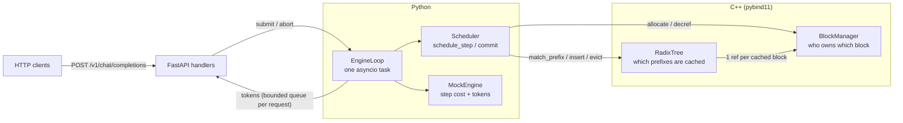

# PrefixServe: Multi-Tenant LLM Serving with RadixAttention & Paged KV Cache

A continuous batching LLM server, built from scratch:

- a **C++ core** with a paged KV block pool and a radix prefix cache
- a **Python scheduler** that decides what runs each step
- an **OpenAI-style HTTP server** with streaming
- a **fake-clock simulation** that compares it against static batching

The model is a mock. The point is the memory management and scheduling, which work the same whether the blocks hold real KV tensors or not.

**Headline (simulated, see [Simulation](#simulation-results)):** on a multi-tenant workload where requests share system prompts, continuous batching with the prefix cache gives **1.8x–3.3x the output throughput of static batching**. At 8 req/s, it cuts p99 time-to-first-token from **55s to 0.21s**. These numbers come from a simulated clock with a made-up cost model. They are not GPU measurements.

---

## The problem

When many users share one LLM server, three things go wrong:

1. **Memory fragmentation.** Each request's KV cache grows one token at a time. Give each request one big buffer, and you either reserve too much or run out. Free memory ends up split into gaps too small to use.
2. **Repeated work.** Many requests start with the same system prompt. Without sharing, every request recomputes and stores the same KV.
3. **Prefill/decode interference.** A long prompt processed in one go stalls token generation for every other user.

## The approach

| Problem | Fix |
|---|---|
| Fragmentation | **Paged KV cache.** Memory is a pool of fixed 16-token blocks. A request holds a list of block ids, not one buffer. No external fragmentation. Internal waste is at most 15 slots per request. |
| Repeated work | **Radix prefix cache.** A tree maps token prefixes to the blocks that already hold their KV. A new request reuses every full block it matches. |
| Interference | **Chunked prefill + decode priority.** Prompts are processed in chunks under a per-step token budget. Decodes don't use that budget, so they run every step. |

---

## Architecture



One step of the engine loop:

```
schedule_step()  ->  engine runs the batch  ->  commit(sampled tokens)  ->  push tokens to each client's queue
```

The tree and the block pool are **decoupled**:

- The **tree** only knows *which token prefixes* are cached, and which block holds each one.
- The **block manager** only knows *who owns each block*, via ref counts.
- Ref counts live in one place. The tree holds 1 ref per cached block, and each request holds 1 ref per block it uses. So `ref_count == 1` means "only the cache holds it, safe to evict".

---

## How it works

### 1. BlockManager (C++)

A fixed pool of KV blocks, allocated once at startup.

- **Free list** is a pre-sized stack. Last freed, first reused, because that block is still warm in CPU cache.
- **Ref counting:** `allocate()` gives ref 1, `incref` and `decref` change it, and at 0 the block goes back on the free list.
- **There is no `free_block()`.** A direct free would ignore other owners and hand their memory to someone else.
- **Double free is always rejected**, not just in debug builds. A block on the free list twice means two requests later write into the same memory.
- Errors are return codes, not exceptions. These calls run every step.

### 2. RadixTree (C++)

A prefix cache with **one node per 16-token block**.

- **Why one node per block:** KV memory is shared a whole block at a time. A tree edge that ends halfway through a block can't share that block. One node per block also means nodes ≤ blocks, so every array is sized once at startup.
- **Children are found by hashing all 16 tokens, not the first token.** Two sibling blocks can start with the same token and differ later, for example `"You are a helpful…"` vs `"You are an expert…"`. A first-token key returns the wrong KV. A test covers exactly this.
- **Hash:** NH (from UMAC) with random keys picked at startup.
  - 8 independent multiplies, so the CPU runs them side by side. It measured **8.5ns per block vs 52ns** for a chained hash.
  - Random keys mean a tenant can't craft prompts that all collide.
  - Every hit is checked with `memcmp` on the real tokens.
- **Each node's 16 tokens = 64 bytes = one cache line**, aligned.
- **One flat open-addressing hash table** with backward-shift deletion. No tombstones, no rehash.
- **LRU eviction:** leaves sit in a min-heap by last access. Each node stores its heap position, so updates are O(log n). Leaves in use (`ref_count > 1`) are skipped. When a leaf goes, its parent may become evictable.
- **`insert` is all-or-nothing.** Every new block is checked before anything changes.

### 3. Scheduler (Python)

Every request has a token list `seq = prompt + output` and a counter `num_computed`, the number of tokens whose KV is in memory.

- Each step processes some of `seq[num_computed:]`.
- If that reaches the end of `seq`, the engine samples one new token.
- **Decode** = 1 token left. **Prefill** = more. **Recompute after preemption** = prefill again.

That's one code path for all three.

Each step:

1. **Running requests, oldest first.** Decode gets 1 token. Prefill gets `min(512, tokens left, budget left)`.
2. **Admit waiting requests, FIFO,** up to `max_decode_seqs` running.
   - Match the cache on `seq[:-1]`, so at least 1 token is always computed.
   - Allocate blocks for the first chunk only.
3. **Out of memory?** First evict cached blocks. If still short, **preempt the newest running request**.
4. **Admission never preempts.** That only causes thrashing.

**Why it can't get stuck:** the oldest request can always take memory from newer ones. `add_request` rejects anything that couldn't fit in the whole pool alone. So the oldest always finishes, then the next, and so on.

**Preemption is cheap:** before releasing, a preempted request puts its blocks into the cache. When it comes back, it usually matches them again.

**Abort during a batch is deferred to `commit`.** The GPU may still be writing that request's KV.

### 4. Server (FastAPI)

`POST /v1/chat/completions`, OpenAI-style, with `stream: true` for Server-Sent Events.

- **One `EngineLoop` asyncio task** owns the scheduler. HTTP handlers only `submit` and `abort`. Same thread, so no locks.
- **The loop never waits on a client.** Tokens go into a bounded per-request queue with `put_nowait`. A client that falls behind by 256 tokens is cut off. Otherwise one slow reader would stall everyone or grow memory forever.
- One queue slot is always reserved for the final "done" event, so it can't be lost.
- **Client disconnect → abort → blocks come back.** Starlette cancels the stream generator, and its `finally` aborts the request.
- **Backpressure:** waiting queue full → `429` with `Retry-After`. Prompt can never fit → `400`. Engine down or shutting down → `503`.
- **Deadlines:** every request has a timeout (`504` / error event).
- **Graceful shutdown:** stop admitting, let running requests finish (up to a timeout), then cut off the rest.
- **Engine crash:** every open request gets an error, and `/health` returns `503` so an orchestrator restarts the process.
- `GET /metrics`: free and cached blocks, prefix hit rate, preemptions, aborts, tokens/s.

### 5. Mock engine and tokenizer

- **Cost per batch step** = `base + prefill tokens × c1 + decode requests × c2`. **One cost per step, not per token per request**, because a GPU runs the whole batch in one forward pass. Charging every request its own delay would make batching look useless.
- **Byte-level tokenizer**, 1 token per UTF-8 byte. Streaming uses an incremental decoder, so a multi-byte character (like 👋) is never printed half-done.
- **Chat template** puts the system prompt first, so every request from the same tenant starts with the same tokens. That's what the cache reuses.

---

## Simulation results

`bench/sim.py` replays one workload through three schedulers on a **fake clock**. Nothing sleeps, so Python and OS overhead don't affect the results, and the same seed gives the same numbers.

**This is not a GPU benchmark.** The cost model numbers are made up. That's why it runs three cost profiles: the conclusions should hold across all of them.

**Workload:**
- 500 requests, Poisson arrivals
- 8 tenants, each with a 768-token system prompt
- User message 32–256 tokens, output 32–256 tokens

**Same limits for every mode:** 4096 blocks (65k tokens), 64 running requests.

**Modes:**
- **Static batching:** take what's queued and run it until the longest request finishes. Memory is reserved for the full prompt and output up front. The whole prompt is processed in one step. Finished requests still take up a slot.
- **Continuous, no cache:** this scheduler with the prefix cache turned off.
- **Continuous + prefix cache:** the full system.

### Throughput (output tokens/s, simulated)

| Cost profile | Load | Static | Continuous, no cache | Continuous + cache | Cache vs static |
|---|---|---|---|---|---|
| default | 8 req/s | 612 | 827 | 1,099 | **1.8x** |
| default | 16 req/s | 614 | 832 | 1,500 | **2.4x** |
| prefill-heavy | 8 req/s | 347 | 407 | 1,073 | **3.1x** |
| prefill-heavy | 16 req/s | 348 | 407 | 1,153 | **3.3x** |
| decode-heavy | 8 req/s | 461 | 723 | 886 | **1.9x** |
| decode-heavy | 16 req/s | 464 | 727 | 917 | **2.0x** |

### Latency at 8 req/s, default profile (simulated)

| Mode | TTFT p50 | TTFT p99 | Time between tokens p50 | p99 |
|---|---|---|---|---|
| Static batching | 27.6s | 55.1s | 32ms | 32ms |
| Continuous, no cache | 7.8s | 21.2s | 83ms | 84ms |
| Continuous + cache | **0.06s** | **0.21s** | 28ms | 64ms |

TTFT = time to first token.

**What to read from this:**
- The prefix cache matters most when prefill is expensive. That's the prefill-heavy profile, at 3.1–3.3x.
- Static batching has the smoothest time between tokens, because it never mixes prefill into decode steps. It pays for that with huge waits to start: 55s p99.
- At 16 req/s every mode is overloaded, so the queue grows and TTFT climbs. The cache just pushes that point further out.
- Prefix hit rate was 83% of prompt tokens on this workload.

### Prefill budget trade-off (8 req/s, default profile, no cache)

| Budget per step | Output tok/s | Time between tokens p99 |
|---|---|---|
| 256 | 725 | 55ms |
| **512** | **827** | **84ms** |
| 1024 | 829 | 135ms |
| 2048 | 828 | 224ms |

A bigger prefill budget means longer steps, so every decode waits longer. **512 gives the same throughput as 2048 with 2.7x lower p99 time between tokens.** So 512 is the default. With the cache on, the budget barely matters, because most of each prompt is cached.

Full results, including p50s, preemptions and every profile × load: `bench/results.json`.

---

## Measured performance (real, not simulated)

| What | Result |
|---|---|
| `match_prefix` on a fully cached 2048-token prompt (128 blocks), C++ | **~3.7µs** (~29ns per block) |
| NH hash of one 16-token block | 8.5ns (chained hash: 52ns) |
| `schedule_step()` wall time, Python, 64 running requests | **~50–100µs** average |
| End to end: 200 concurrent streams on the real server, 10% hang up mid-stream | all 200 return 200, 17 aborts, 91% prefix hits, **0 leaked blocks** |

Intel Mac, Release build.

---

## Testing

| Suite | What it checks | Tests |
|---|---|---|
| `tests/cpp/test_core.cpp` | Block manager and tree, built with **ASan + UBSan**. Randomized test checks every block's ref count against a model after each of 4000 ops. | 18 |
| `tests/cpp/test_no_alloc.cpp` | Swaps in a counting `operator new`, asserts **0 allocations** in the hot path, and checks the counter itself works. | 3 |
| `tests/test_core_bindings.py` | Python boundary: errors, copies vs views, `keep_alive`. | 13 |
| `tests/test_scheduler.py` | One test per scheduler rule: decode priority, chunking, budget, prefix reuse, preemption, deferred abort, rejections. | 16 |
| `tests/test_invariants.py` | **Hypothesis state machine.** Random add / abort / step with aborts mid-batch. After every step, every block's `ref_count == (1 if cached) + (live requests holding it)`. At the end: no livelock, no leaks. | 300 runs × 60 steps |
| `tests/test_server.py` | **Real uvicorn on a real socket.** Streaming, 429, 400/422, client disconnect frees blocks, 50 concurrent streams, slow client cut off, shutdown drain, engine crash → 503. | 11 |
| `tests/test_tokenizer.py` | UTF-8 round trip, streaming multi-byte characters, shared prefixes. | 4 |

Also:
- `mypy --strict` is clean.
- Every test has a 120s timeout.
- **The tests were checked by injecting bugs** and confirming each one is caught:
  - block leak on preemption
  - freeing blocks mid-batch
  - a scheduler infinite loop
  - no abort on client disconnect
  - unbounded buffering for slow clients

---

## Build and run

Needs Python ≥ 3.11, CMake ≥ 3.20, and a C++17 compiler.

```bash
python3 -m venv .venv
.venv/bin/pip install -e ".[test]"      # builds the C++ extension

.venv/bin/python -m pytest -q           # all Python tests
.venv/bin/mypy --strict prefixserve     # type check
.venv/bin/python bench/sim.py           # simulation -> bench/results.json
```

### Run the server

```bash
.venv/bin/prefixserve --port 8000       # or: python -m prefixserve.server
```

```bash
curl -N localhost:8000/v1/chat/completions -H 'content-type: application/json' -d '{
  "messages": [{"role": "system", "content": "You are helpful."},
               {"role": "user", "content": "hi"}],
  "max_tokens": 20, "stream": true}'

curl localhost:8000/metrics
```

### C++ tests and benchmark

```bash
cmake -S . -B build/tests -DCMAKE_BUILD_TYPE=Debug -DPREFIXSERVE_BUILD_TESTS=ON
cmake --build build/tests && ./build/tests/test_core && ./build/tests/test_no_alloc

cmake -S . -B build/release -DCMAKE_BUILD_TYPE=Release -DPREFIXSERVE_BUILD_TESTS=ON -DPREFIXSERVE_SANITIZE=OFF
cmake --build build/release --target micro_core && ./build/release/micro_core
```

### Using the scheduler directly

```python
from prefixserve import Scheduler

s = Scheduler(num_blocks=1024, eos_token_id=2)
s.add_request("user-1", prompt=[1, 15, 27, 99, 4], max_tokens=32)

while s.has_work():
    batch = s.schedule_step(max_prefill_tokens=512, max_decode_seqs=64)
    # A real engine runs the model on batch.work here.
    sampled = {w.req.req_id: 42 for w in batch.work if w.samples}
    result = s.commit(batch, sampled)

print(s.stats())
```

---

## Project layout

```
csrc/
  block_manager.hpp/.cpp   KV block pool + ref counting
  radix_tree.hpp/.cpp      prefix cache, hash table, LRU heap
  bindings.cpp             pybind11 module prefixserve._core
prefixserve/
  scheduler.py             continuous batching scheduler
  server.py                FastAPI server + EngineLoop
  mock_engine.py           cost model + fake tokens
  tokenizer.py             byte-level tokenizer, chat template
  _core.pyi                type hints for the C++ module
tests/
  cpp/                     GoogleTest (sanitized) + allocation counter
  test_*.py                pytest, Hypothesis, real-socket server tests
bench/
  micro_core.cpp           match_prefix timing
  sim.py                   fake-clock scheduler simulation
  results.json             latest simulation output
```

## Known limits

- **No real model or GPU.** Blocks are ids, not GPU memory. The simulation uses made-up costs.
- **Single process.** One scheduler, one asyncio task. No multi-GPU.
- **Preemption is recompute only.** No swapping KV to CPU memory.
- **Byte-level tokenizer.** Prompts are ~3–4x more tokens than with a real BPE tokenizer.
- **Python GC pauses.** About 1 in 1300 scheduler steps hits a ~3ms garbage collector pause. I measured `gc.freeze()` and it didn't help, so it isn't used.
- **Blocks are 16 tokens, fixed at compile time.**
